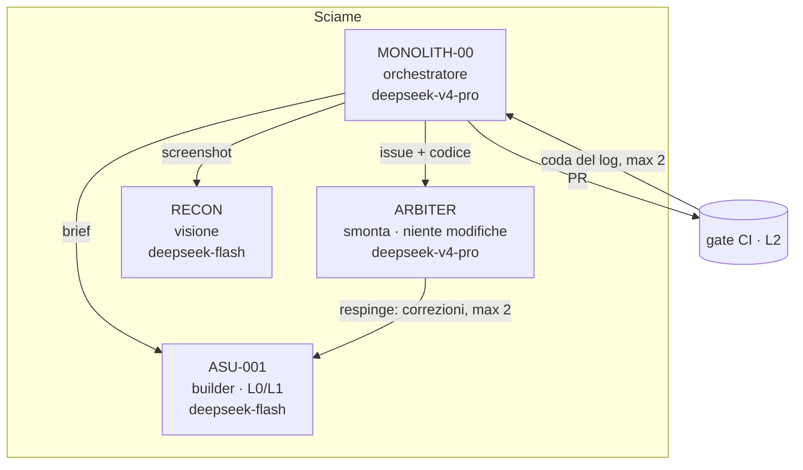
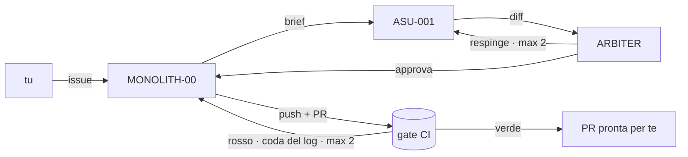

# MECHANUS

Uno sciame self-hosted di agenti AI per programmare, che pianifica, costruisce,
revisiona e rilascia codice un'issue alla volta.

[](LICENSE)
[](https://opencode.ai)

---

## Cos'è

MECHANUS trasforma una sola macchina in un piccolo team di sviluppo che lavora
**un'issue alla volta** tenendo bassi i costi: un modello economico costruisce, un
modello forte a contesto pulito prova a smontare il lavoro, e i gate di test lenti
girano una volta per PR in CI, mai dentro il ciclo degli agenti.

Esiste in due forme che condividono lo stesso metodo (`skills/mechanus/SKILL.md`):

- **Lo sciame** — OpenCode 2 su una LXC bare-metal, agenti su DeepSeek (va bene
  qualsiasi provider), guidato da `bin/loop.sh` su una lista di issue.
- **La skill** — lo stesso metodo dentro una sessione di Claude Code o OpenCode sul
  tuo PC: la sessione orchestra, `builder` (Sonnet) e `arbiter` (Opus) sono i suoi
  subagenti.

## Architettura



## Agenti

| Agente | Ruolo | Modello (sciame) | Claude Code |
|--------|-------|------------------|-------------|
| **MONOLITH-00** | Orchestratore — parla con te, scrive issue e brief, prende le decisioni di prodotto, unisce, riporta | `deepseek/deepseek-v4-pro` | la sessione stessa |
| **ASU-001** | Builder — un'issue nel suo worktree, TDD, solo L0/L1, committa, non pusha | `deepseek/deepseek-flash` | `builder` (Sonnet) |
| **ARBITER** | Arbitro — contesto pulito, prova a **smontare** il diff rispetto all'issue, misura; non può modificare file | `deepseek/deepseek-v4-pro` | `arbiter` (Opus) |
| **RECON** | Visione — guarda gli screenshot e riporta a parole; non può modificare file | `deepseek/deepseek-flash` | non serve (Claude vede le immagini) |

Consiglio: un arbitro di **un'altra famiglia di modelli** rispetto al builder trova
di più — un modello tende a dare ragione a ciò che ha generato lui.

## Workflow

1. **Intervista** (solo se la richiesta è vaga): `interview-me`, una domanda alla volta.
2. **Issue**: cosa, perché, quando è fatta, cosa NON fare. L'issue è memoria e punto
   di ripartenza. Le decisioni di prodotto sono tue o di MONOLITH, mai del builder.
3. **Smistamento**: logica verificabile coi test → builder; gusto dell'interfaccia,
   sistemi veri, API sconosciute e ritocchi da poche righe → orchestratore. Le issue
   banali saltano l'arbitro. Issue che toccano gli stessi file non vanno in parallelo.
4. **Worktree** per issue (`<tipo>/<n>-<slug>`); prima si controlla che lì i test girino.
5. **Builder**: brief da `brief-builder.md` con file di partenza, decisioni già prese,
   comandi esatti, divieti.
6. **Arbitro**: riceve l'issue e il codice (mai il ragionamento del builder) da
   `brief-arbitro.md`, lancia L1 e le sue prove, approva solo se non riesce a smontare.
7. **Ciclo**: le correzioni tornano alla stessa sessione del builder; **massimo 2
   rifiuti**, poi tu.
8. **Unione**: una PR alla volta; solo l'orchestratore fa rebase, aggiorna
   CHANGELOG/TODO, pusha e chiude l'issue.
9. **Misura**: token, tempo, giri dell'arbitro e della CI per issue.



### Livelli di verifica: perché resta economico e veloce

L'`AGENTS.md` di ogni progetto indica tre comandi (modello nell'`AGENTS.md` della radice):

| Livello | Cosa | Durata | Chi |
|---------|------|--------|-----|
| L0 | lint, tipi, build | secondi | builder mentre lavora |
| L1 | i test di ciò che si tocca | minuti | builder alla fine, arbitro con le sue prove |
| L2 | suite completa / e2e | minuti… ore | **una volta per PR**: pre-push se è corto, **CI** se è lungo |

Gli agenti non lanciano mai L2. L'output dei test è la cosa che pesa di più in un
contesto, e su un progetto con un gate da 2 ore il vecchio ciclo lo lanciava fino a
tre volte per giro di revisione.

### Aspettare la CI senza modello (`bin/loop.sh`)

`bin/loop.sh` prima lavora le issue, poi aspetta la CI di ogni PR con `gh pr checks --watch` (nessun modello, zero token), passa a MONOLITH solo la coda del log che fallisce e si ferma dopo `MAX_CI_ROUNDS` (di base 2) giri di correzione. Le PR verdi vengono elencate, mai unite da sole.

### Gate di CI su GitHub (`templates/github/gate.yml`)

Un solo workflow per tutti i progetti: prima L0, poi la suite completa divisa in pezzi paralleli.
I **repo pubblici** girano sui runner di GitHub `ubuntu-latest` (gratis, 4 CPU / 16 GB). I **repo privati** girano su un runner self-hosted effimero in una LXC dedicata (nessun minuto di GitHub, RAM a scelta), scelto da solo con `github.event.repository.private`. Mai un runner self-hosted su un repo pubblico.

LXC del runner (separata da quella di MECHANUS): `bin/new-runner-lxc.sh`, poi un PAT fine-grained («Administration: read and write» su quei repo) in `/etc/gh-runner.env`, poi un `systemctl enable --now gh-runner@<owner>--<repo>--<n>` per ogni pezzo parallelo. Ogni istanza prende un job, cancella la sua cartella e si registra di nuovo.

## Modelli e provider

Ogni agente fissa il proprio modello, quindi lo sciame può girare su un **mix** di
provider. Aggiungi un provider una volta, poi puntaci qualsiasi agente.

| Agente | Campo in `opencode.json` | Esempio di cambio |
|--------|--------------------------|-------------------|
| MONOLITH-00 | `agents["MONOLITH-00"].model` | `qwen/qwen-max` |
| ASU-001 | `agents["ASU-001"].model` | `deepseek/deepseek-flash` |
| ARBITER | `agents["ARBITER"].model` | `anthropic/claude-sonnet-4-6` |
| RECON | `agents["RECON"].model` | `deepseek/deepseek-flash` |

Aggiungi un provider:

```bash
opencode auth login qwen     # interattivo: incolla la API key
```

Poi cambia il campo `model` dell'agente e riavvia opencode.

## Setup

1. Installa **OpenCode 2** (la modalità subagent in background lo richiede):

   ```bash
   curl -fsSL https://opencode.ai/install | bash
   opencode upgrade --major
   ```

2. Autentica i tuoi provider (`opencode auth login …`).
3. Clona i tuoi repo in `/workspace/` e correggi i puntatori in `AGENTS.md`.

## Claude Code

Lo stesso metodo gira dentro una sessione di Claude Code, senza server: la sessione fa da MONOLITH, `builder` (Sonnet) e `arbiter` (Opus) sono i suoi subagenti, ogni issue ha il suo worktree git.

```bash
bin/install-claude.sh        # collega skills/mechanus e claude/agents in ~/.claude
```

**OpenCode** (V2) legge anche `~/.claude/skills`, quindi su una macchina con tutti e due basta il collegamento sopra. Sulla LXC bare-metal (solo OpenCode): `ln -sfn /workspace/mechanus/skills/mechanus ~/.config/opencode/skills/mechanus`. In `opencode.json` ARBITER e RECON non possono modificare file (`permissions`) e ASU/ARBITER hanno un tetto di passi (`steps`), così un ciclo impazzito si ferma da solo.

Poi chiedi a Claude Code di «lavorare la issue #42 con mechanus». La skill (`skills/mechanus/SKILL.md`) contiene la procedura e i modelli dei brief; lo stesso `SKILL.md` vale in OpenCode, dove builder e arbitro sono ASU-001 e ARBITER.

## Deploy (bare-metal, ufficiale)

Il deploy ufficiale è **bare-metal**: OpenCode 2 gira direttamente sull'host sotto
systemd. Nessun container è coinvolto.

### 1. Installa OpenCode 2

```bash
curl -fsSL https://opencode.ai/install | bash
opencode upgrade --major 2.3.0        # fissa la versione
ln -sf /root/.opencode/bin/opencode /usr/local/bin/opencode
```

### 2. Config globale

OpenCode legge la config globale da `/root/.config/opencode/opencode.json`.
Copia lì la config del repo:

```bash
mkdir -p /root/.config/opencode
cp /workspace/mechanus/opencode.json /root/.config/opencode/opencode.json
```

I `system` prompt degli agenti usano **path assoluti**
(`/workspace/mechanus/agents/*.md`), quindi tieni il checkout in
`/workspace/mechanus` oppure aggiorna quei path.

### 3. Chiave provider (mai committata)

Questo repo **non contiene API key**. Fornisci la chiave DeepSeek in uno di
questi modi:

- Login interattivo, salvato nell'auth store di OpenCode (fuori da git):

  ```bash
  opencode auth login deepseek
  ```

- Un blocco `provider` solo nella config **globale**:

  ```json
  {
    "provider": {
      "deepseek": { "options": { "apiKey": "sk-…" } }
    }
  }
  ```

- Da una variabile d'ambiente: tieni `DEEPSEEK_API_KEY` in un env file leggibile
  solo da root e iniettala nella config globale al momento del deploy:

  ```bash
  jq --arg k "$DEEPSEEK_API_KEY" \
    '.provider.deepseek.options.apiKey = $k' \
    /root/.config/opencode/opencode.json > /tmp/oc.json \
    && mv /tmp/oc.json /root/.config/opencode/opencode.json
  ```

La convenzione `<PROVIDER>_API_KEY` resta valida (es. `QWEN_API_KEY`).

### 4. Unità systemd + config del servizio

La web UI è servita dal **background service** di OpenCode, eseguito sotto
systemd. Il servizio legge hostname/porta/password da
`/root/.config/opencode/service.json`:

```json
{
  "hostname": "0.0.0.0",
  "port": 4096,
  "password": "<generata>"
}
```

(`opencode service get password` stampa la password corrente.)

`/etc/systemd/system/opencode-web.service`:

```ini
[Unit]
Description=OpenCode Web UI
After=network.target

[Service]
Type=simple
User=root
Environment=PATH=/root/.opencode/bin:/usr/local/bin:/usr/bin:/bin
ExecStart=/root/.opencode/bin/opencode serve --service
Restart=on-failure
RestartSec=5

[Install]
WantedBy=multi-user.target
```

Poi:

```bash
systemctl daemon-reload
systemctl enable --now opencode-web
```

- In ascolto sulla **porta 4096** (da `service.json`).
- Lo username dell'auth basic è sempre `opencode`; la password è quella in
  `service.json` (generata e mantenuta da OpenCode).

### 5. Esposizione (Traefik, senza login)

Il servizio è pubblicato su **https://ai.yourdomain.com** tramite Traefik, che
termina il TLS e **inietta l'auth basic di OpenCode su ogni richiesta**, così la
web UI funziona **senza login e senza pairing** (in modo permanente — OpenCode V2
non ha modalità "senza auth", quindi è il proxy a fornire le credenziali).
L'accesso resta limitato alla LAN tramite un `ipAllowList`. Esempio di config
dinamica Traefik:

```yaml
http:
  middlewares:
    lan-only:
      ipAllowList:
        sourceRange:
          - "192.168.0.0/16"
          - "100.64.0.0/10"
    opencode-auth:
      headers:
        customRequestHeaders:
          Authorization: "Basic <base64(opencode:<password>)>"
  routers:
    ai:
      rule: Host(`ai.yourdomain.com`)
      entryPoints: [websecure]
      service: opencode
      middlewares: [lan-only@file, opencode-auth@file]
  services:
    opencode:
      loadBalancer:
        servers:
          - url: "http://<LAN_IP>:4096"
```

`<base64(opencode:<password>)>` = `printf 'opencode:%s' "$PW" | base64`.
Chiunque è sulla LAN può usare la web UI senza login; per ripristinare l'SSO
basta ri-aggiungere un middleware `oauth@file` al router.

### Aggiornamenti

```bash
git -C /workspace/mechanus pull
opencode upgrade --major <versione>
systemctl restart opencode-web
```

## Docker (test locale / al volo)

> **Secondario.** Usa Docker per testare in locale o tirare su lo sciame al volo
> senza toccare l'host. Il deploy ufficiale è bare-metal (vedi sopra).

Il setup container (OpenCode 2 + provider iniettati da env):

```bash
cp .env.example .env        # compila i tuoi *_API_KEY
docker compose up -d --build
```

- Web UI su http://localhost:4096 (`PORT` in `.env`).
- I repo dei progetti sono montati in `/workspace` (`WORKSPACE_PATH` in `.env`).
- Lo stato (sessioni, auth) persiste nel volume `mechanus-state`.
- Aggiungi un provider: aggiungi `QWEN_API_KEY=…` a `.env` e riavvia.
- Aggiorna: `git pull && docker compose up -d --build`.

## Struttura

- `opencode.json` — definizioni degli agenti (modelli, ruoli, system prompt)
- `agents/` — il system prompt di ogni agente
- `AGENTS.md` — indice dei progetti (puntatori all'`AGENTS.md` di ogni repo)
- `templates/github/gate.yml` — modello del gate di CI (L0 + L2 a pezzi, runner scelto in base alla visibilità del repo)
- `bin/` — script (`issue.sh`, `loop.sh`, `new-lxc.sh`)
- `docker/` — setup container per test locale (Dockerfile, entrypoint, compose)
- `skills/mechanus/` — il metodo MECHANUS come skill portabile (Claude Code e OpenCode): intervista → issue → builder → arbitro → PR
- `claude/agents/` — builder (Sonnet) e arbitro (Opus) per Claude Code; `bin/install-claude.sh` li collega, con la skill, in `~/.claude`
- `skills/` — set di skill curato

## Accesso

- **Web UI**: `https://ai.yourdomain.com` (Traefik, solo LAN, senza login) oppure
  `http://<IP_LAN>:4096` in LAN (auth basic: `opencode` / password del servizio).
- **SSH**: `ssh root@<IP_LAN>` (LAN) oppure `ssh root@<TUO_HOST_NETBIRD>` (NetBird).

## Provisioning

### Sull'host Proxmox (una tantum)

Crea la LXC (VMID `<VMID>`, Ubuntu, **privileged**, dimensioni a tua scelta). Abilita
**Features → Nesting** (`keyctl` è solo per container unprivileged; saltalo). Poi:

```bash
# IP statico + DNS (il gateway/router è <IP_GATEWAY>; adatta alla tua LAN)
pct set <VMID> -net0 name=eth0,bridge=vmbr0,firewall=1,hwaddr=<MAC>,ip=<IP_LAN>/24,gw=<IP_GATEWAY>,type=veth
pct set <VMID> -nameserver <IP_GATEWAY>
# Docker richiede AppArmor disabilitato (vedi gotchas)
echo 'lxc.apparmor.profile: unconfined' >> /etc/pve/lxc/<VMID>.conf
pct reboot <VMID>
```

Poi esegui i passi dentro la LXC con `bin/new-lxc.sh`.

### Dentro la LXC

```bash
git clone https://github.com/dexRand/mechanus.git /workspace/mechanus
bash /workspace/mechanus/bin/new-lxc.sh
```

Poi imposta i segreti (mai in git):

```bash
opencode auth login        # DeepSeek API key
# GitHub fine-grained PAT -> ~/.git-credentials (vedi new-lxc.sh)
gh auth login              # bin/loop.sh aspetta la CI con gh
ln -sfn /workspace/mechanus/skills/mechanus ~/.config/opencode/skills/mechanus
```

## Gotchas noti (sudati)

- **CPU vecchia (senza AVX2)**: i binari bun compilati per AVX2 vanno in `SIGILL`.
  Preferisci tool Go/Rust/C o Python, oppure immagini Docker, quando aggiungi software.
- **Docker + AppArmor in LXC**: `lxc.apparmor.profile: unconfined` da solo NON basta —
  Docker non riesce ancora a caricare il profilo `docker-default`. La fix funzionante è
  `mv /usr/sbin/apparmor_parser /usr/sbin/apparmor_parser.disabled` (un futuro
  `apt upgrade` potrebbe ripristinarlo).
- **NetBird riscrive `/etc/resolv.conf`** col suo IP (`100.67.x.x`), rompendo il DNS
  (e quindi `netbird up` stesso). Fix: blocca `resolv.conf` (`chattr +i`) o imposta un
  nameserver DNS nel pannello NetBird.
- **Le setup key NetBird sono monouso** — un `netbird down` seguito da `up` può restare
  in "login backoff" finché il DNS non è fixato E non usi una setup key nuova.

## Principi

- **Guidato dalle issue** — l'issue è memoria e stato.
- **Chi costruisce non è chi verifica** — contesto pulito, mandato di smontare, misure.
- **Le decisioni restano alle persone** — il builder esegue, non decide mai cosa è un errore.
- **I gate lenti una volta sola** — gli agenti usano L0/L1; L2 gira una volta per PR e lo aspetta uno script.
- **Limiti veri, non solo parole** — tetto di passi, modifiche negate all'arbitro, giri massimi contati dallo script.
- **Token minimi** — caricare solo ciò che serve, brief corti, code dei log invece dei log interi.
- **Atomico** — un worktree, un branch, una PR per issue.
- **Semplice, non un framework** — una macchina, un token, niente cerimonie sandbox.

## Licenza

[GNU AGPL-3.0](./LICENSE) — Copyright (C) 2026 dexRand.
