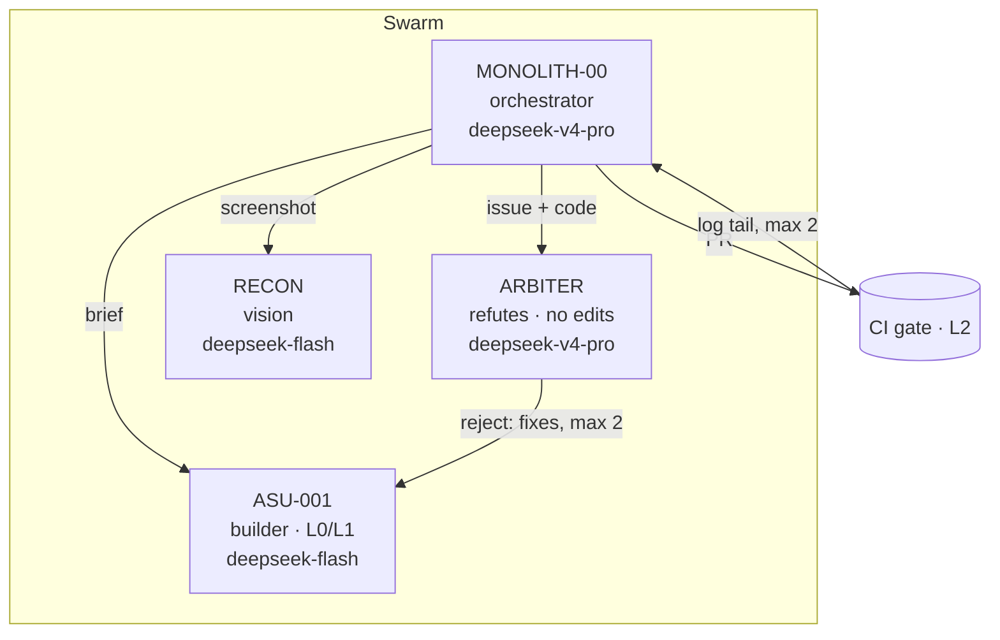
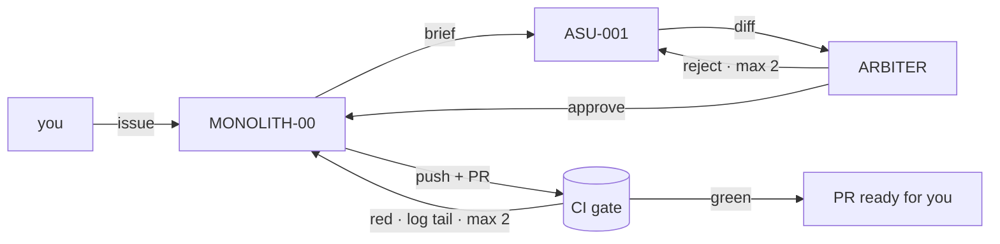

# MECHANUS

A self-hosted swarm of AI coding agents that plan, build, review, and ship code
one issue at a time.

[](LICENSE)
[](https://opencode.ai)

---

## What it is

MECHANUS turns a single machine into a small dev team that works **one issue at a
time** and keeps costs down: a cheap model builds, a strong model with a clean
context tries to tear the work apart, and slow test gates run once per PR in CI,
never inside the agents' loop.

It comes in two forms that share one method (`skills/mechanus/SKILL.md`):

- **The swarm** — OpenCode 2 on a bare-metal LXC, agents on DeepSeek (any provider
  works), driven by `bin/loop.sh` through a list of issues.
- **The skill** — the same method inside a Claude Code or OpenCode session on your
  machine: the session orchestrates, `builder` (Sonnet) and `arbiter` (Opus) are its
  subagents.

## Architecture



## Agents

| Agent | Role | Model (swarm) | Claude Code |
|-------|------|---------------|-------------|
| **MONOLITH-00** | Orchestrator — talks to you, writes issues and briefs, takes product decisions, merges, reports | `deepseek/deepseek-v4-pro` | the session itself |
| **ASU-001** | Builder — one issue in its own worktree, TDD, L0/L1 only, commits, never pushes | `deepseek/deepseek-flash` | `builder` (Sonnet) |
| **ARBITER** | Arbiter — clean context, tries to **refute** the diff against the issue, measures; cannot edit | `deepseek/deepseek-v4-pro` | `arbiter` (Opus) |
| **RECON** | Vision — inspects screenshots and reports in text; cannot edit | `deepseek/deepseek-flash` | not needed (Claude sees images) |

Tip: an arbiter from a **different model family** than the builder catches more —
models tend to agree with what they generated.

## Workflow

1. **Interview** (only for vague requests): `interview-me`, one question at a time.
2. **Issue**: what, why, when it is done, what NOT to do. The issue is memory and
   resume point. Product decisions are yours or MONOLITH's, never the builder's.
3. **Triage**: testable logic → builder; UI taste, real systems, unknown APIs and
   few-line touches → orchestrator. Trivial issues skip the arbiter. Issues touching
   the same files never run in parallel.
4. **Worktree** per issue (`<type>/<n>-<slug>`); check that tests run there first.
5. **Builder** gets a brief from `brief-builder.md`: start files, decisions already
   taken, exact commands, red lines.
6. **Arbiter** gets the issue and the code (never the builder's reasoning) from
   `brief-arbitro.md`, runs L1 and its own probes, approves only if it fails to
   refute.
7. **Loop**: fixes go back to the same builder session; **max 2 rejections**, then you.
8. **Merge**: one PR at a time; only the orchestrator rebases, updates
   CHANGELOG/TODO, pushes and closes the issue.
9. **Measure**: tokens, time, arbiter rounds, CI rounds per issue.



### Check levels: why it stays cheap and fast

Each project's `AGENTS.md` names three commands (template in the root `AGENTS.md`):

| Level | What | Time | Who |
|-------|------|------|-----|
| L0 | lint, types, build | seconds | builder while working |
| L1 | tests of what you touch | minutes | builder at the end, arbiter with its probes |
| L2 | full suite / e2e | minutes… hours | **once per PR**: pre-push if short, **CI** if long |

Agents never run L2. Test output is the heaviest thing in a context, and on a project
with a 2-hour gate the old loop ran it up to three times per review round.

### Waiting for CI without a model (`bin/loop.sh`)

`bin/loop.sh` works the issues first, then waits for every PR's CI with `gh pr checks --watch` (no model, zero tokens), hands MONOLITH only the tail of a failing log, and stops after `MAX_CI_ROUNDS` (default 2) fix rounds. Green PRs are listed, never auto-merged.

### CI gate on GitHub (`templates/github/gate.yml`)

One workflow for every project: L0 first, then the full suite split into parallel shards.
**Public repos** run on GitHub-hosted `ubuntu-latest` (free, 4 CPU / 16 GB). **Private repos** run on a self-hosted, ephemeral runner in its own LXC (no GitHub minutes, RAM of your choice), chosen automatically by `github.event.repository.private`. Never attach a self-hosted runner to a public repo.

Runner LXC (separate from the MECHANUS one): `bin/new-runner-lxc.sh`, then a fine-grained PAT ("Administration: read and write" on those repos) in `/etc/gh-runner.env`, then one `systemctl enable --now gh-runner@<owner>--<repo>--<n>` per parallel shard. Each instance takes one job, wipes its workspace and registers again.

## Models & providers

Each agent pins its own model, so the swarm can run on a **mix** of providers.
Add a provider once, then point any agent at it.

| Agent | Field in `opencode.json` | Example swap |
|-------|--------------------------|--------------|
| MONOLITH-00 | `agents["MONOLITH-00"].model` | `qwen/qwen-max` |
| ASU-001 | `agents["ASU-001"].model` | `deepseek/deepseek-flash` |
| ARBITER | `agents["ARBITER"].model` | `anthropic/claude-sonnet-4-6` |
| RECON | `agents["RECON"].model` | `deepseek/deepseek-flash` |

Add a provider:

```bash
opencode auth login qwen     # interactive: paste the API key
```

Then change the agent's `model` field and restart opencode.

## Setup

1. Install **OpenCode 2** (the background-subagent mode requires it):

   ```bash
   curl -fsSL https://opencode.ai/install | bash
   opencode upgrade --major
   ```

2. Authenticate your model providers (`opencode auth login …`).
3. Clone your project repos into `/workspace/` and fix the pointers in `AGENTS.md`.

## Claude Code

The same method runs inside a Claude Code session, no server needed: the session is MONOLITH, `builder` (Sonnet) and `arbiter` (Opus) are its subagents, each issue gets its own git worktree.

```bash
bin/install-claude.sh        # links skills/mechanus and claude/agents into ~/.claude
```

**OpenCode** (V2) also reads `~/.claude/skills`, so on a machine with both the link above is enough. On the bare-metal LXC (OpenCode only): `ln -sfn /workspace/mechanus/skills/mechanus ~/.config/opencode/skills/mechanus`. In `opencode.json` ARBITER and RECON cannot edit (`permissions`) and ASU/ARBITER have a `steps` cap, so a runaway loop stops by itself.

Then ask Claude Code to "work issue #42 with mechanus". The skill (`skills/mechanus/SKILL.md`) holds the procedure and the brief templates; the same `SKILL.md` works in OpenCode, where the builder and arbiter are ASU-001 and ARBITER.

## Deployment (bare-metal, official)

The official deployment is **bare-metal**: OpenCode 2 runs directly on the host
under systemd. No container is involved.

### 1. Install OpenCode 2

```bash
curl -fsSL https://opencode.ai/install | bash
opencode upgrade --major 2.3.0        # pin the version
ln -sf /root/.opencode/bin/opencode /usr/local/bin/opencode
```

### 2. Global config

OpenCode reads its global config from `/root/.config/opencode/opencode.json`.
Copy the repo config there:

```bash
mkdir -p /root/.config/opencode
cp /workspace/mechanus/opencode.json /root/.config/opencode/opencode.json
```

The agent `system` prompts use **absolute paths**
(`/workspace/mechanus/agents/*.md`), so keep the checkout at
`/workspace/mechanus` or update those paths.

### 3. Provider key (never committed)

This repo carries **no API key**. Supply the DeepSeek key in one of these ways:

- Interactive login, stored in OpenCode's auth store (outside git):

  ```bash
  opencode auth login deepseek
  ```

- A `provider` block in the **global** config only:

  ```json
  {
    "provider": {
      "deepseek": { "options": { "apiKey": "sk-…" } }
    }
  }
  ```

- From an env var: keep `DEEPSEEK_API_KEY` in a root-only env file and inject it
  into the global config at deploy time:

  ```bash
  jq --arg k "$DEEPSEEK_API_KEY" \
    '.provider.deepseek.options.apiKey = $k' \
    /root/.config/opencode/opencode.json > /tmp/oc.json \
    && mv /tmp/oc.json /root/.config/opencode/opencode.json
  ```

The `<PROVIDER>_API_KEY` naming convention is preserved (e.g. `QWEN_API_KEY`).

### 4. systemd unit + service config

The web UI is served by OpenCode's **background service**, run under systemd.
The service reads its hostname/port/password from
`/root/.config/opencode/service.json`:

```json
{
  "hostname": "0.0.0.0",
  "port": 4096,
  "password": "<generated>"
}
```

(`opencode service get password` prints the current password.)

`/etc/systemd/system/opencode-web.service`:

```ini
[Unit]
Description=OpenCode Web UI
After=network.target

[Service]
Type=simple
User=root
Environment=PATH=/root/.opencode/bin:/usr/local/bin:/usr/bin:/bin
ExecStart=/root/.opencode/bin/opencode serve --service
Restart=on-failure
RestartSec=5

[Install]
WantedBy=multi-user.target
```

Then:

```bash
systemctl daemon-reload
systemctl enable --now opencode-web
```

- Listens on **port 4096** (from `service.json`).
- Basic-auth username is always `opencode`; the password is the one in
  `service.json` (generated and kept by OpenCode).

### 5. Exposure (Traefik, no login)

The service is published at **https://ai.yourdomain.com** through Traefik, which
terminates TLS and **injects OpenCode's basic auth on every request**, so the web
UI works with **no login and no pairing** (permanently — OpenCode V2 has no
"unsecured" mode, so the proxy supplies the credentials). Access stays restricted
to the LAN via an `ipAllowList`. Example Traefik dynamic config:

```yaml
http:
  middlewares:
    lan-only:
      ipAllowList:
        sourceRange:
          - "192.168.0.0/16"
          - "100.64.0.0/10"
    opencode-auth:
      headers:
        customRequestHeaders:
          Authorization: "Basic <base64(opencode:<password>)>"
  routers:
    ai:
      rule: Host(`ai.yourdomain.com`)
      entryPoints: [websecure]
      service: opencode
      middlewares: [lan-only@file, opencode-auth@file]
  services:
    opencode:
      loadBalancer:
        servers:
          - url: "http://<LAN_IP>:4096"
```

`<base64(opencode:<password>)>` = `printf 'opencode:%s' "$PW" | base64`.
Anyone on the LAN can use the web UI without logging in; to require SSO again,
add an `oauth@file` middleware to the router.

### Updates

```bash
git -C /workspace/mechanus pull
opencode upgrade --major <version>
systemctl restart opencode-web
```

## Docker (local testing / on-demand)

> **Secondary.** Use Docker to test locally or bring the swarm up quickly without
> touching the host. The official deployment is bare-metal (see above).

The container setup (OpenCode 2 + providers injected from env):

```bash
cp .env.example .env        # fill in your *_API_KEY values
docker compose up -d --build
```

- Web UI on http://localhost:4096 (`PORT` in `.env`).
- Project repos are mounted at `/workspace` (`WORKSPACE_PATH` in `.env`).
- State (sessions, auth) persists in the `mechanus-state` volume.
- Add a provider: append `QWEN_API_KEY=…` to `.env` and restart.
- Update: `git pull && docker compose up -d --build`.

## Layout

- `opencode.json` — agent definitions (models, roles, system prompts)
- `agents/` — the system prompt for each agent
- `AGENTS.md` — project index (pointers to each repo's own `AGENTS.md`)
- `templates/github/gate.yml` — CI gate template (L0 + sharded L2, runner chosen by repo visibility)
- `bin/` — scripts (`issue.sh`, `loop.sh`, `new-lxc.sh`)
- `docker/` — container setup for local testing (Dockerfile, entrypoint, compose)
- `skills/mechanus/` — the MECHANUS method as a portable skill (Claude Code and OpenCode): interview → issue → builder → arbiter → PR
- `claude/agents/` — Claude Code builder (Sonnet) and arbiter (Opus); `bin/install-claude.sh` links them and the skill into `~/.claude`
- `skills/` — curated skill set

## Access

- **Web UI**: `https://ai.yourdomain.com` (Traefik, LAN-only, no login) or
  `http://<LAN_IP>:4096` on the LAN (basic auth: `opencode` / service password).
- **SSH**: `ssh root@<LAN_IP>` (LAN) or `ssh root@<YOUR_NETBIRD_HOST>` (NetBird).

## Provisioning

### On the Proxmox host (once)

Create the LXC (VMID `<VMID>`, Ubuntu, **privileged**, sizing up to you). Enable
**Features → Nesting** (`keyctl` is unprivileged-only; skip it). Then:

```bash
# Static IP + DNS (gateway/router is <GATEWAY_IP>; adjust to your LAN)
pct set <VMID> -net0 name=eth0,bridge=vmbr0,firewall=1,hwaddr=<MAC>,ip=<LAN_IP>/24,gw=<GATEWAY_IP>,type=veth
pct set <VMID> -nameserver <GATEWAY_IP>
# Docker needs AppArmor disabled (see gotchas)
echo 'lxc.apparmor.profile: unconfined' >> /etc/pve/lxc/<VMID>.conf
pct reboot <VMID>
```

Then install the in-LXC steps with `bin/new-lxc.sh`.

### Inside the LXC

```bash
git clone https://github.com/dexRand/mechanus.git /workspace/mechanus
bash /workspace/mechanus/bin/new-lxc.sh
```

Then set the secrets (never in git):

```bash
opencode auth login        # DeepSeek API key
# GitHub fine-grained PAT -> ~/.git-credentials (see new-lxc.sh)
gh auth login              # bin/loop.sh waits for CI with gh
ln -sfn /workspace/mechanus/skills/mechanus ~/.config/opencode/skills/mechanus
```

## Known gotchas (hard-won)

- **Old CPU (no AVX2)**: bun-compiled binaries built for AVX2 crash with `SIGILL`.
  Prefer Go/Rust/C or Python tools, or Docker images, when adding software.
- **Docker + AppArmor in LXC**: `lxc.apparmor.profile: unconfined` alone is NOT
  enough — Docker still fails to load its `docker-default` profile. The working fix
  is `mv /usr/sbin/apparmor_parser /usr/sbin/apparmor_parser.disabled` (a future
  `apt upgrade` may restore it).
- **NetBird rewrites `/etc/resolv.conf`** to its own IP (`100.67.x.x`), which breaks
  DNS (and thus `netbird up` itself). Fix: pin `resolv.conf` (`chattr +i`) or set a
  DNS nameserver in the NetBird dashboard.
- **NetBird setup keys are one-time** — a `netbird down` followed by `up` can get
  stuck in "login backoff" until DNS is fixed AND a fresh setup key is used.

## Principles

- **Issue-driven** — the issue is memory and state.
- **Separate who builds from who checks** — clean context, mandate to refute, measure.
- **Decisions stay with humans** — the builder executes, it never decides what is an error.
- **Slow gates once** — agents run L0/L1; L2 runs once per PR, waited for by a script.
- **Hard limits, not just words** — step caps, edit denied to the arbiter, max rounds counted by the script.
- **Minimal tokens** — load only what is needed, short briefs, log tails instead of logs.
- **Atomic** — one worktree, one branch, one PR per issue.
- **Simple, not a framework** — one machine, one token, no sandbox ceremony.

## License

[GNU AGPL-3.0](./LICENSE) — Copyright (C) 2026 dexRand.
